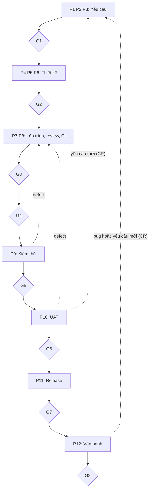

# Tổng quan vòng đời phát triển (12 phase)

## Mục đích

File này mô tả một yêu cầu thay đổi (Change Request, CR) đi từ lúc tiếp nhận, phân tích,
thiết kế, xây dựng, kiểm thử, nghiệm thu đến phát hành và vận hành ra sao, ai tham gia, và AI
đứng ở đâu. Chi tiết gate, mức AI và quy tắc an toàn nằm ở các file riêng; ở đây chỉ dẫn chiếu.

Dự án áp dụng quy trình có AI tham gia gồm 12 phase (P1 đến P12), 8 gate (G1 đến G8), 4 stage
sản phẩm (POC, Demo, MVP, Production) và 5 mức tự chủ của AI (L0 đến L4).

Nguồn: tài liệu "Quy trình phát triển phần mềm có AI tham gia", mục 1.1 đến 1.4, 2.1 đến 2.7,
3.2 và 4.2. Phần đánh dấu `[Đề xuất]` là bổ sung cho dự án này, không có nguyên văn trong
tài liệu gốc.

`[Đề xuất]` Giữ nguyên thuật ngữ tiếng Anh quen thuộc (phase, gate, baseline, sign-off, cycle,
stage, traceability) để thống nhất với tài liệu gốc và các file khác trong repo.

Hai chỗ tài liệu gốc không thống nhất:

- Hình tổng quan ghi "5 gate chính", bảng ở mục 3.1 liệt kê 8 gate: dùng 8 gate (xem
  `docs/00-process/gates.md`).
- Hình đặt G2 sau P6, còn mục 2.2 nhắc G2 ngay sau phần P4 đến P5: dùng cách của hình
  (G2 ở cuối nhóm thiết kế, sau P6).

## Năm điều cần nhớ

1. Mỗi thay đổi đi qua 12 phase và 8 gate. Gate nào cũng do con người sign-off.
2. AI là trợ lý, không phải người chịu trách nhiệm. AI tạo draft, rà soát, sinh test case,
   chạy việc lặp lại. AI không được approve, không được nghiệm thu, không được quyết định
   scope hay ưu tiên.
3. Người (hoặc AI) tạo ra sản phẩm không tự duyệt chính sản phẩm đó.
4. Mỗi yêu cầu có AC, mỗi AC có test case, nên ai cũng biết "xong" nghĩa là gì.
5. Release nào cũng qua UAT, kể cả MVP. Hotfix chỉ được thu gọn UAT, không được bỏ.

## Bức tranh tổng quan

Một yêu cầu đi từ trên xuống qua bốn nhóm công việc. Chưa có sign-off của người có thẩm quyền
thì chưa được đi tiếp.



Đọc từ trên xuống: BA và PO làm nhóm đầu; Tester vào từ P6 để chuẩn bị test song song với
thiết kế; Dev làm nhóm xây dựng; khách hàng nghiệm thu ở P10. Khi có defect, công việc quay
lại P7 để sửa. Khi UAT hoặc vận hành sinh ra yêu cầu mới, công việc quay lại P1 dưới dạng CR mới.

| Nhóm           | Phase         | Vai trò chính                           | Gate ở cuối nhóm |
| --------------- | ------------- | ----------------------------------------- | ------------------- |
| Yêu cầu       | P1 đến P3   | BA, PO                                    | G1                  |
| Thiết kế      | P4 đến P6   | Architect, Tech Lead (Tester vào từ P6) | G2                  |
| Build và test  | P7 đến P9   | Dev, Tester                               | G3, G4, G5          |
| UAT và release | P10 đến P12 | Khách hàng, DevOps                      | G6, G7, G8          |

## Mười hai phase

| Phase | Tên                                   | Vai trò chính                          | Mức AI thường dùng | Gate   |
| ----- | -------------------------------------- | ---------------------------------------- | ---------------------- | ------ |
| P1    | Tiếp nhận và làm rõ yêu cầu     | BA, PO                                   | L2                     |        |
| P2    | Phân tích nghiệp vụ                | BA, PO                                   | L2                     |        |
| P3    | Đặc tả yêu cầu (SRS) và AC       | BA, PO                                   | L2 đến L3            | G1     |
| P4    | Thiết kế                             | Architect, Tech Lead                     | L2                     |        |
| P5    | Lập kế hoạch                        | Tech Lead, PM; PO duyệt thứ tự        | L1                     |        |
| P6    | Thiết kế kiểm thử                  | QA (Tester)                              | L2 đến L3            | G2     |
| P7    | Lập trình                            | Developer                                | L3                     |        |
| P8    | Review và CI                          | Tech Lead, Dev                           | L2 đến L4            | G3, G4 |
| P9    | Kiểm thử tích hợp, hệ thống, NFR | QA                                       | L3                     | G5     |
| P10   | UAT                                    | Khách hàng hoặc key user; BA hỗ trợ | L1 đến L2            | G6     |
| P11   | Release                                | Release Manager, DevOps                  | L3                     | G7     |
| P12   | Vận hành                             | SRE, Support, PM                         | L2 đến L3            | G8     |

Ai ký từng gate, điều kiện và bằng chứng: xem `docs/00-process/gates.md`.
Ý nghĩa các mức AI và trạng thái Draft, Verified, Approved: xem `docs/00-process/ai-levels.md`.

## Chi tiết từng phase

Mã trong ngoặc (S01, T1, U1...) là mã bước của tài liệu gốc, mục 2. Tài liệu gốc gộp P4 và P5
khi mô tả; việc chia bước vào hai phase này là theo tên phase.

### P1: Tiếp nhận và làm rõ yêu cầu

- Kết quả: một CR đã được làm rõ, có mức ưu tiên; PO đã quyết định nhận, hoãn hay từ chối.
- Nhận yêu cầu thô từ email, cuộc họp, ticket (S01).
- Chuẩn hóa thành CR có mã, mục tiêu, bối cảnh, stakeholder (S02).
- Rà soát chỗ mơ hồ, thiếu, mâu thuẫn (S03).
- Họp làm rõ với khách hàng; AI không chốt ý định thay khách hàng (S04).
- Triage: phân loại và xếp ưu tiên; PO quyết định (S05).
- Điều kiện qua P1: CR đủ trường bắt buộc, không còn câu hỏi mở loại blocker, PO đã triage.
  Nếu PO từ chối hoặc hoãn, CR được đóng.

### P2: Phân tích nghiệp vụ

- Kết quả: hiểu rõ quy trình hiện tại và mong muốn, mục tiêu, scope, người dùng và ràng buộc.
- Vẽ quy trình hiện tại (as-is) và mong muốn (to-be) (S06).
- Xác định mục tiêu, giá trị, scope: BRD hoặc PRD (S07).
- Viết user story, use case (S08).
- Đánh giá ràng buộc pháp lý và bảo mật ở mức nghiệp vụ (S09).

### P3: Đặc tả yêu cầu (SRS) và AC

- Kết quả: SRS mà mọi bên cùng hiểu một nghĩa, mỗi yêu cầu kèm AC để biết thế nào là "xong".
- Viết FR, mỗi yêu cầu một mã, một ý (S10); viết NFR có con số đo (S11).
- Viết AC dạng Given (cho trước), When (khi), Then (thì) (S12).
- Kiểm tra chất lượng yêu cầu tự động: đơn nghĩa, đo được, khả thi, có truy vết (S13).
- Review chéo giữa BA, PO, Dev, QA (S14). Có finding hoặc PO yêu cầu sửa thì quay lại S10.
- Kết thúc bằng G1; sau G1, SRS thành baseline.

### P4: Thiết kế

- Kết quả: thiết kế đã được kiểm tra truy vết với yêu cầu, có threat model.
- Impact analysis lên hệ thống hiện có (S15).
- Chọn phương án kiến trúc và ghi lại lý do; AI so sánh ưu nhược, con người chọn (S16).
- Thiết kế chi tiết: API, data model, luồng xử lý (S17).
- Threat modeling; con người xác nhận mức rủi ro (S18).
- Kiểm tra truy vết thiết kế với yêu cầu (S19).

### P5: Lập kế hoạch

- Kết quả: backlog đã phân rã, có ước lượng và lịch; mỗi task gắn nhãn AI được làm hay không.
- Phân rã backlog, ước lượng, lập lịch; PO duyệt thứ tự, cam kết do team (S20, S21).
- Gắn nhãn task `ai-eligible` hoặc `human-only` theo độ phức tạp và độ nhạy cảm (S22).

### P6: Thiết kế kiểm thử

- Kết quả: test strategy, test case, test data và kế hoạch test NFR; Tester bắt đầu sớm,
  song song với thiết kế, không chờ có code.
- Test strategy và test plan: scope, entry và exit criteria, rủi ro (S23).
- Thiết kế test case positive, negative, boundary từ AC; Tester đọc lại, bổ sung case thiếu
  và loại case vô nghĩa (S24).
- Chuẩn bị test data (dữ liệu tổng hợp hoặc đã che) và môi trường test (S25).
- Kế hoạch test NFR: hiệu năng, bảo mật (S26).
- Kiểm tra coverage: yêu cầu nào chưa có test (S27).
- Kết thúc bằng G2.

### P7: Lập trình

- Kết quả: code và unit test cho task đã gắn với yêu cầu, kèm pull request.
- Nhận task, viết code và unit test; AI chỉ làm task `ai-eligible`, vùng nhạy cảm chỉ ở mức
  draft (S28, S29).
- Tạo pull request kèm mô tả, cập nhật API doc (S30, S31).

### P8: Review và CI

- Kết quả: code đã được review và build đã qua CI.
- CI tự kiểm tra mỗi thay đổi: build, lint, unit test, security scan, dependency scan,
  secret scan. Pass hay fail do CI quyết định, không dùng AI để phán (S32).
- Code review: AI review sơ bộ, con người quyết định merge (S33).
- Merge và đóng gói build; chỉ thay đổi rủi ro thấp đã định nghĩa trước mới được merge tự động,
  và chỉ khi mọi kiểm tra tự động đạt (S34).
- AI tự sửa tối đa một số vòng cố định, hết thì báo con người.
- Kết thúc bằng G3 (merge) và G4 (build sẵn sàng để test).

### P9: Kiểm thử tích hợp, hệ thống, NFR

- Kết quả: báo cáo kiểm thử, defect đã được quản lý, bằng chứng coverage.
- T1 integration test; T2 system test và E2E theo AC; T3 regression; T4 performance và load;
  T5 security (quét lỗ hổng, pen-test do con người).
- T6 exploratory test: thử tự do để tìm defect mà kịch bản không lường.
- T7 quản lý defect: QA ghi nhận, Tech Lead phân công, PO quyết ưu tiên và chấp nhận defect
  còn lại.
- Kết thúc bằng G5.

### P10: UAT

- Kết quả: kết quả UAT và bằng chứng nghiệm thu của khách hàng.
- Chuẩn bị UAT: kịch bản từ AC, môi trường, hướng dẫn, đào tạo (U1).
- Khách hàng hoặc key user tự thao tác và tự đánh giá; AI chỉ ghi nhận và phân loại phản hồi (U2).
- Xử lý defect và CR phát sinh; phân biệt defect với yêu cầu mới để tránh scope creep (U3).
- UAT bắt buộc cho mọi release; build đóng băng khi đang UAT; phản hồi Demo không thay thế UAT.
- Kết thúc bằng G6.

### P11: Release

- Kết quả: release package, bằng chứng triển khai.
- Chuẩn bị release: release note, kế hoạch deploy và rollback, change ticket (D1).
- Deploy dần: staging, rồi canary hoặc blue-green, rồi production (D2).
- Smoke test và health check sau deploy (D3).
- Kết thúc bằng G7.

### P12: Vận hành

- Kết quả: số liệu vận hành, hồ sơ incident, kết quả retrospective.
- Monitoring log, metric, SLO (O1); xử lý incident (O2).
- Hỗ trợ người dùng, thu phản hồi; bug hoặc yêu cầu mới quay về P1 (O3).
- Retrospective và đo lường (O4).
- Kết thúc bằng G8.

## Truy vết

Các mối liên kết sau phải được duy trì xuyên suốt vòng đời:

```text
Change Request (CR)
        |
        v
Yêu cầu nghiệp vụ
        |
        v
FR và NFR
        |
        v
Acceptance Criteria (AC)
        |
        v
Thiết kế
        |
        v
Task và code
        |
        v
Test case và kết quả test
        |
        v
Release
```

Yêu cầu tối thiểu:

- Mỗi FR truy về một CR và có ít nhất một AC.
- Mỗi AC có ít nhất một test case; mỗi test case truy về một AC.
- Mỗi FR có thiết kế; mỗi task trong backlog truy về một FR.
- Truy vết hai chiều: yêu cầu, thiết kế, code, test, release.
- Nguyên tắc V-model: mỗi mức đặc tả có một mức kiểm thử tương ứng.
- Sau G1, SRS là baseline: mọi thay đổi sau đó phải đi qua CR mới, và các test bị ảnh hưởng
  được đánh dấu là cũ (stale).

## Ai tham gia

Có hai kiểu vai trò: người thực hiện (Responsible) và người chịu trách nhiệm cuối cùng, ký
duyệt (Accountable). Người chịu trách nhiệm cuối cùng luôn là con người, kể cả khi AI thực hiện.
Ai ký gate nào xem `docs/00-process/gates.md`.

| Vai trò                   | Làm gì trong dự án                                                          |
| -------------------------- | ------------------------------------------------------------------------------- |
| Khách hàng hoặc Sponsor | Nêu nhu cầu, làm rõ ý định, đồng ý yêu cầu, tham gia UAT            |
| PO                         | Quyết định ưu tiên và scope, chịu trách nhiệm về giá trị sản phẩm |
| BA                         | Thu thập, phân tích, viết yêu cầu và AC, chuẩn bị UAT                  |
| Tester hoặc QA            | Thiết kế test, chạy test, quản lý defect, báo cáo chất lượng          |
| Architect hoặc Tech Lead  | Thiết kế giải pháp, chia task, review code                                  |
| Developer                  | Viết code và unit test, sửa defect                                           |
| Security hoặc Compliance  | Kiểm tra bảo mật và tuân thủ pháp lý                                    |
| DevOps hoặc SRE           | Deploy, monitoring, xử lý incident                                            |
| PM hoặc Release Manager   | Kế hoạch và lịch release                                                    |
| UX hoặc UI Designer       | Thiết kế giao diện và trải nghiệm                                         |
| Support                    | Nhận phản hồi, hỗ trợ người dùng                                        |

## Hai lớp: stage và cycle

- Cycle là một lượt đi qua P1 đến P12, kết thúc bằng một release.
- Stage cho biết sản phẩm đã trưởng thành đến đâu.
- Mọi cycle dẫn tới một release đều phải có UAT và gate G6, kể cả release MVP.
- Milestone gate M1 đến M4 chuyển giữa các stage (xem `docs/00-process/gates.md`).

| Stage      | Câu hỏi cần trả lời                                  | Dữ liệu                          | UAT và G6                       | Mức AI tối đa           |
| ---------- | --------------------------------------------------------- | ---------------------------------- | -------------------------------- | -------------------------- |
| POC        | Làm được về kỹ thuật không?                       | Synthetic                          | Không                           | L3 đến L4 (code bỏ đi) |
| Demo       | Có đáng đầu tư, có đúng ý khách hàng không?  | Synthetic hoặc anonymized         | Không                           | L3                         |
| MVP        | Người dùng thật có dùng và thấy giá trị không? | Dữ liệu thật, kiểm soát chặt | Bắt buộc                       | L2 đến L3, có gate      |
| Production | Mở rộng và vận hành bền vững được không?       | Dữ liệu thật                    | Bắt buộc, độ sâu theo scope | L2 đến L3, có ngưỡng  |

Bốn điều cần nhớ về stage:

- Phản hồi Demo không phải UAT, và Demo không phải cam kết: chỉ SRS đã qua G1 mới là cam kết
  về scope.
- MVP cắt scope, không cắt chuẩn: thiếu bớt chức năng thì được, thiếu UAT, test, bảo mật
  hay traceability thì không.
- Pilot phải giới hạn được bằng kỹ thuật (feature flag, allowlist, theo vùng), không chỉ bằng
  thỏa thuận. Mở rộng cho mọi người dùng là một release mới, có Go/No-go và UAT riêng.
- Code POC không được đưa thẳng vào MVP mà không viết lại và review.

## Quản lý thay đổi, defect và hotfix

Khi khách hàng đổi yêu cầu sau khi SRS đã thành baseline:

1. Tạo CR mới.
2. Làm impact analysis.
3. Cập nhật SRS lên phiên bản mới.
4. Đánh dấu các test bị ảnh hưởng là cũ (stale).
5. Quay lại gate tương ứng.

Quản lý defect:

- Defect phát hiện khi kiểm thử được ghi nhận và phân loại.
- Tech Lead phân công xử lý kỹ thuật; PO quyết ưu tiên nghiệp vụ và việc chấp nhận defect còn lại.
- Thay đổi code quay lại P7; bug trên production và yêu cầu mới từ vận hành quay về P1.

Các tình huống đặc biệt:

| Tình huống                                        | Điều chỉnh                                                                                                                                                                                                                                                 |
| --------------------------------------------------- | ------------------------------------------------------------------------------------------------------------------------------------------------------------------------------------------------------------------------------------------------------------- |
| Bug khẩn trên production (hotfix)                 | Rút gọn P3 và P4 thành mini-SRS và mini-TDD; UAT tối thiểu do PO hoặc key user xác nhận, kèm UAT bổ sung có lịch sau deploy. Bắt buộc giữ: test case tái hiện bug, review của con người, kế hoạch rollback. Hotfix không bỏ gate G6 |
| Thay đổi nhỏ, rủi ro thấp (đổi text, config) | Có thể gộp P1 đến P4 thành một ticket; AI tối đa L3; vẫn qua CI và review                                                                                                                                                                          |
| Khách hàng đổi yêu cầu giữa chừng           | Như các bước ở trên                                                                                                                                                                                                                                     |
| Làm theo sprint (agile)                            | P3 đến P9 lặp theo từng sprint; G1 và G2 áp dụng cho từng increment; G6 ở mỗi sprint review                                                                                                                                                         |

## Sai lầm thường gặp về quy trình

Các sai lầm liên quan an toàn (đẩy POC thành sản phẩm, hiểu MVP là bỏ test, pilot mở rộng ngầm,
release không có rollback) xem `docs/00-process/safety-rules.md`.

| Sai lầm                                   | Hậu quả                                | Cách tránh                                                                           |
| ------------------------------------------ | ---------------------------------------- | -------------------------------------------------------------------------------------- |
| Coi Demo là UAT, hoặc MVP không qua UAT | Release bản chưa được nghiệm thu   | Không có đường đi bỏ qua G6; phản hồi Demo không dùng làm bằng chứng UAT |
| Khách hàng hiểu Demo là cam kết       | Tranh chấp scope                        | Ghi rõ "chưa baseline"; chỉ SRS đã qua G1 là cam kết                            |
| Sửa code liên tục trong lúc UAT        | Không biết đã nghiệm thu build nào | Đóng băng build, sửa có phiên bản, UAT lại phần bị ảnh hưởng              |
| Hotfix bỏ UAT hoàn toàn                 | Regression trên production              | UAT tối thiểu là bắt buộc, kèm UAT bổ sung có lịch                            |

## Phase trong repo này

`[Đề xuất]` Mỗi phase để chứng cứ ở đâu trong repo.

| Phase       | Sản phẩm                                                             | Vị trí trong repo                                                                            |
| ----------- | ---------------------------------------------------------------------- | ---------------------------------------------------------------------------------------------- |
| P1          | CR                                                                     | GitHub Issue theo mẫu `.github/ISSUE_TEMPLATE/change-request.md`                            |
| P2          | BRD, quy trình nghiệp vụ, user story                                | `docs/01-requirements/vision-brd.md`                                                         |
| P3          | SRS, AC, ma trận truy vết                                            | `docs/01-requirements/srs.md`, `acceptance-criteria.md`, `traceability.md`               |
| P4          | Kiến trúc, threat model, quyết định thiết kế, quyền hạn agent | `docs/02-design/architecture.md`, `threat-model.md`, `decisions/`, `agent-autonomy.md` |
| P5          | Backlog, bản đồ module, nhãn task                                  | `docs/02-design/module-map.md`; GitHub Issues và nhãn `ai-eligible`, `human-only`      |
| P6          | Test strategy, kế hoạch đánh giá                                  | `docs/03-test/test-strategy.md`, `eval-plan.md`                                            |
| P7 đến P8 | Code, pull request, CI                                                 | Pull request; `.github/workflows/`; (thư mục code chưa có)                               |
| P9          | Kết quả test, defect                                                 | `docs/03-test/`; Issue theo mẫu `bug.md`                                                  |
| P10         | Kịch bản và kết quả UAT                                           | `docs/03-test/`                                                                              |
| P11         | Checklist phát hành, kế hoạch rollback                             | `docs/04-release/release-checklist.md`; tag và release trên GitHub                         |
| P12         | Chỉ số, tổng kết, bug và CR mới quay về P1                      | `docs/05-retro/`; GitHub Issues                                                              |

Ngoài vòng đời của tool chính:

- `labs/` và `poc/`: ở mức POC, code bỏ đi, dữ liệu giả; không đi qua G1 đến G8
  (xem `docs/00-process/gates.md`).
- `experiments/`: so sánh hai model, theo `docs/00-process/experiment-protocol.md`.
- `docs/06-roadmap/` và `docs/07-career/`: kế hoạch và lộ trình học tập.

Cycle đầu tiên của dự án (phạm vi, mục tiêu): (bạn điền).

## Bảo trì tài liệu quy trình

`[Đề xuất]` Khi quy trình thay đổi:

1. Cập nhật file này và các file quy trình có liên quan (`gates.md`, `ai-levels.md`,
   `safety-rules.md`, `experiment-protocol.md`).
2. Kiểm tra phase, gate và các sản phẩm của dự án còn nhất quán với nhau.
3. Ghi lý do và ngày ở mục Phiên bản; Git history giữ vết thay đổi.
4. Có thể điều chỉnh quy trình khi dự án đổi stage, nhưng ba nguyên tắc không đổi: con người
   chịu trách nhiệm và ký duyệt, truy vết được, mọi release qua nghiệm thu (UAT).

## Tài liệu liên quan

- `docs/00-process/gates.md`: 8 gate, milestone, ai ký, bằng chứng.
- `docs/00-process/ai-levels.md`: mức AI L0 đến L4 và ba trạng thái.
- `docs/00-process/safety-rules.md`: quy tắc an toàn khi dùng AI.
- `docs/00-process/experiment-protocol.md`: quy tắc so sánh hai model.
- `docs/06-roadmap/plan.md`: kế hoạch và việc cần làm cho gate tiếp theo.

## Phiên bản

- v1, (ngày): bản đầu, gộp từ hai bản nháp (Claude và GPT) và đối chiếu với tài liệu gốc.
