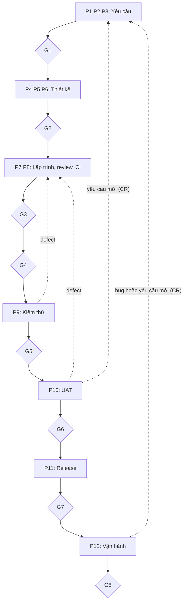

# Tổng quan vòng đời phát triển (12 phase)

## Mục đích

File này mô tả một yêu cầu đi từ ý tưởng tới phần mềm chạy thật như thế nào qua 12 phase
(P1 đến P12), ai tham gia, và AI đứng ở đâu. Chi tiết nằm ở các file khác, ở đây chỉ dẫn chiếu.

Nguồn: tài liệu "Quy trình phát triển phần mềm có AI tham gia", mục 1.1 đến 1.4, 2.1 đến 2.7,
3.2 và 4.2. Phần đánh dấu `[Đề xuất]` là bổ sung cho dự án này, không có nguyên văn trong
tài liệu gốc.

Hai chỗ tài liệu gốc không thống nhất:

- Hình tổng quan ghi "5 gate chính", bảng ở mục 3.1 liệt kê 8 gate: dùng 8 gate (xem
  `docs/00-process/gates.md`).
- Hình đặt G2 sau P6, còn mục 2.2 nhắc G2 ngay sau phần P4 đến P5: dùng cách của hình
  (G2 ở cuối nhóm thiết kế, sau P6).

## Năm điều cần nhớ

1. Mỗi thay đổi đi qua 12 phase và 8 gate. Gate nào cũng do con người sign-off.
2. AI là trợ lý, không phải người chịu trách nhiệm. AI tạo draft, rà soát, sinh test case,
   chạy việc lặp lại. AI không được approve, không được nghiệm thu, không được quyết định
   scope hay ưu tiên.
3. Người (hoặc AI) tạo ra sản phẩm không tự duyệt chính sản phẩm đó.
4. Mỗi yêu cầu có AC, mỗi AC có test case, nên ai cũng biết "xong" nghĩa là gì.
5. Release nào cũng qua UAT, kể cả MVP. Hotfix chỉ được thu gọn UAT, không được bỏ.

## Bức tranh tổng quan

Một yêu cầu đi từ trên xuống qua bốn nhóm công việc. Chưa có sign-off của người có thẩm quyền
thì chưa được đi tiếp.

Đọc từ trên xuống: BA và PO làm nhóm đầu; Tester vào từ P6 để chuẩn bị test song song với
thiết kế; Dev làm nhóm xây dựng; khách hàng nghiệm thu ở P10. Khi có defect, công việc quay
lại P7 để sửa. Khi UAT hoặc vận hành sinh ra yêu cầu mới, công việc quay lại P1 dưới dạng CR mới.

## Mười hai phase

| Phase | Tên                                   | Kết quả                                                                                 | Vai trò chính                          | Mức AI thường dùng | Gate   |
| ----- | -------------------------------------- | ----------------------------------------------------------------------------------------- | ---------------------------------------- | ---------------------- | ------ |
| P1    | Tiếp nhận và làm rõ yêu cầu     | CR đã làm rõ, có ưu tiên; PO quyết định nhận, hoãn hay từ chối              | BA, PO                                   | L2                     |        |
| P2    | Phân tích nghiệp vụ                | Hiểu quy trình hiện tại và mong muốn, mục tiêu, scope, người dùng, ràng buộc | BA, PO                                   | L2                     |        |
| P3    | Đặc tả yêu cầu (SRS) và AC       | SRS mọi bên cùng hiểu một nghĩa, mỗi yêu cầu có AC                              | BA, PO                                   | L2 đến L3            | G1     |
| P4    | Thiết kế                             | Kiến trúc, thiết kế chi tiết, threat model, truy vết thiết kế với yêu cầu      | Architect, Tech Lead                     | L2                     |        |
| P5    | Lập kế hoạch                        | Backlog, ước lượng, lịch; nhãn task AI được làm hay chỉ con người làm       | Tech Lead, PM; PO duyệt thứ tự        | L1                     |        |
| P6    | Thiết kế kiểm thử                  | Test strategy, test case, test data, kế hoạch test NFR, coverage                        | QA (Tester)                              | L2 đến L3            | G2     |
| P7    | Lập trình                            | Code và unit test cho task đã gắn với yêu cầu; pull request                        | Developer                                | L3                     |        |
| P8    | Review và CI                          | CI tự kiểm tra, review code, merge và đóng gói build                                | Tech Lead, Dev                           | L2 đến L4            | G3, G4 |
| P9    | Kiểm thử tích hợp, hệ thống, NFR | Kết quả các loại test, defect đã quản lý                                          | QA                                       | L3                     | G5     |
| P10   | UAT                                    | Người dùng thật tự thao tác và nghiệm thu                                         | Khách hàng hoặc key user; BA hỗ trợ | L1 đến L2            | G6     |
| P11   | Release                                | Release note, kế hoạch deploy và rollback, deploy dần, smoke test                     | Release Manager, DevOps                  | L3                     | G7     |
| P12   | Vận hành                             | Monitoring, xử lý incident, hỗ trợ người dùng, retrospective                       | SRE, Support, PM                         | L2 đến L3            | G8     |

Ai ký từng gate, điều kiện và bằng chứng: xem `docs/00-process/gates.md`.
Ý nghĩa các mức AI và trạng thái Draft, Verified, Approved: xem `docs/00-process/ai-levels.md`.

Điều kiện qua P1: CR đủ trường bắt buộc, không còn câu hỏi mở loại blocker, PO đã triage.

## Các bước trong từng phase

Tài liệu gốc đánh mã các bước. Bảng dưới là mục lục để tra; chi tiết "ai làm, AI hỗ trợ ở mức nào"
nằm trong mục 2 của tài liệu gốc. Cách chia bước vào P4 và P5 là theo tên phase, vì tài liệu gốc
gộp hai phase này.

| Phase | Mã bước    | Nội dung                                                                                                                                    |
| ----- | ------------- | -------------------------------------------------------------------------------------------------------------------------------------------- |
| P1    | S01 đến S05 | Nhận yêu cầu thô; chuẩn hóa thành CR; rà soát chỗ mơ hồ; họp làm rõ; triage                                                   |
| P2    | S06 đến S09 | Vẽ quy trình hiện tại và mong muốn; mục tiêu, giá trị, scope (BRD, PRD); user story, use case; ràng buộc pháp lý và bảo mật |
| P3    | S10 đến S14 | Viết FR; viết NFR; viết AC; kiểm tra chất lượng yêu cầu tự động; review chéo                                                    |
| P4    | S15 đến S19 | Impact analysis; chọn kiến trúc; thiết kế chi tiết; threat modeling; kiểm tra truy vết thiết kế và yêu cầu                      |
| P5    | S20 đến S22 | Phân rã backlog; ước lượng và lập lịch; gắn nhãn `ai-eligible` hoặc `human-only`                                             |
| P6    | S23 đến S27 | Test strategy và test plan; thiết kế test case; chuẩn bị test data và môi trường; kế hoạch test NFR; kiểm tra coverage           |
| P7    | S28 đến S31 | Nhận task, viết code và unit test; tạo PR; cập nhật API doc                                                                            |
| P8    | S32 đến S34 | Kiểm tra tự động (CI); code review; merge và đóng gói build                                                                          |
| P9    | T1 đến T7   | Integration test; system và E2E; regression; performance; security; exploratory; quản lý defect                                           |
| P10   | U1 đến U3   | Chuẩn bị UAT; thực hiện UAT; xử lý defect và CR phát sinh                                                                            |
| P11   | D1 đến D3   | Chuẩn bị release; deploy dần; smoke test sau deploy                                                                                       |
| P12   | O1 đến O4   | Monitoring; xử lý incident; hỗ trợ người dùng và thu phản hồi; retrospective và đo lường                                       |

## Truy vết

- Mỗi yêu cầu có AC; mỗi AC có ít nhất một test case; mỗi test case truy về một AC.
- Mỗi FR có thiết kế; mỗi task trong backlog truy về một FR.
- Truy vết hai chiều: yêu cầu, thiết kế, code, test, release.
- Nguyên tắc V-model: mỗi mức đặc tả có một mức kiểm thử tương ứng. Tester bắt đầu từ P6,
  song song với thiết kế, không chờ có code.
- Sau G1, SRS là baseline: mọi thay đổi sau đó phải đi qua CR mới.

## Ai tham gia

Có hai kiểu vai trò: người thực hiện (Responsible) và người chịu trách nhiệm cuối cùng, ký
duyệt (Accountable). Người chịu trách nhiệm cuối cùng luôn là con người, kể cả khi AI thực hiện.
Ai ký gate nào xem `docs/00-process/gates.md`.

| Vai trò                   | Làm gì trong dự án                                                          |
| -------------------------- | ------------------------------------------------------------------------------- |
| Khách hàng hoặc Sponsor | Nêu nhu cầu, làm rõ ý định, đồng ý yêu cầu, tham gia UAT            |
| PO                         | Quyết định ưu tiên và scope, chịu trách nhiệm về giá trị sản phẩm |
| BA                         | Thu thập, phân tích, viết yêu cầu và AC, chuẩn bị UAT                  |
| Tester hoặc QA            | Thiết kế test, chạy test, quản lý defect, báo cáo chất lượng          |
| Architect hoặc Tech Lead  | Thiết kế giải pháp, chia task, review code                                  |
| Developer                  | Viết code và unit test, sửa defect                                           |
| Security hoặc Compliance  | Kiểm tra bảo mật và tuân thủ pháp lý                                    |
| DevOps hoặc SRE           | Deploy, monitoring, xử lý incident                                            |
| PM hoặc Release Manager   | Kế hoạch và lịch release                                                    |
| UX hoặc UI Designer       | Thiết kế giao diện và trải nghiệm                                         |
| Support                    | Nhận phản hồi, hỗ trợ người dùng                                        |

## Hai lớp: stage và cycle

- Cycle là một lượt đi qua P1 đến P12, kết thúc bằng một release.
- Stage cho biết sản phẩm đã trưởng thành đến đâu: POC, Demo, MVP, Production.
- Mọi cycle dẫn tới một release đều phải có UAT và gate G6, kể cả release MVP.
- Chỉ POC và Demo không cần UAT; từ MVP trở đi luôn bắt buộc.

Chi tiết các stage và milestone gate (M1 đến M4): xem `docs/00-process/gates.md`.

## Tình huống đặc biệt

| Tình huống                                        | Điều chỉnh                                                                                                                                                                              |
| --------------------------------------------------- | ------------------------------------------------------------------------------------------------------------------------------------------------------------------------------------------ |
| Bug khẩn trên production (hotfix)                 | Rút gọn P3 và P4 thành mini-SRS và mini-TDD; UAT tối thiểu do PO hoặc key user xác nhận. Bắt buộc giữ: test case tái hiện bug, review của con người, kế hoạch rollback |
| Thay đổi nhỏ, rủi ro thấp (đổi text, config) | Có thể gộp P1 đến P4 thành một ticket; AI tối đa L3; vẫn qua CI và review                                                                                                       |
| Khách hàng đổi yêu cầu giữa chừng           | Tạo CR mới, impact analysis, cập nhật SRS phiên bản mới, đánh dấu test bị ảnh hưởng là stale, quay lại gate tương ứng                                                   |
| Làm theo sprint (agile)                            | P3 đến P9 lặp theo từng sprint; G1 và G2 áp dụng cho từng increment; G6 ở mỗi sprint review                                                                                      |

## Sai lầm thường gặp về quy trình

Các sai lầm liên quan an toàn (đẩy POC thành sản phẩm, hiểu MVP là bỏ test, pilot mở rộng ngầm,
release không có rollback) xem `docs/00-process/safety-rules.md`.

| Sai lầm                                   | Hậu quả                                | Cách tránh                                                                           |
| ------------------------------------------ | ---------------------------------------- | -------------------------------------------------------------------------------------- |
| Coi Demo là UAT, hoặc MVP không qua UAT | Release bản chưa được nghiệm thu   | Không có đường đi bỏ qua G6; phản hồi Demo không dùng làm bằng chứng UAT |
| Khách hàng hiểu Demo là cam kết       | Tranh chấp scope                        | Ghi rõ "chưa baseline"; chỉ SRS đã qua G1 là cam kết                            |
| Sửa code liên tục trong lúc UAT        | Không biết đã nghiệm thu build nào | Đóng băng build, sửa có phiên bản, UAT lại phần bị ảnh hưởng              |
| Hotfix bỏ UAT hoàn toàn                 | Regression trên production              | UAT tối thiểu là bắt buộc, kèm UAT bổ sung có lịch                            |

## Phase trong repo này

`[Đề xuất]` Mỗi phase để chứng cứ ở đâu trong repo.

| Phase       | Sản phẩm                                                             | Vị trí trong repo                                                                            |
| ----------- | ---------------------------------------------------------------------- | ---------------------------------------------------------------------------------------------- |
| P1          | CR                                                                     | GitHub Issue theo mẫu `.github/ISSUE_TEMPLATE/change-request.md`                            |
| P2          | BRD, quy trình nghiệp vụ, user story                                | `docs/01-requirements/vision-brd.md`                                                         |
| P3          | SRS, AC, ma trận truy vết                                            | `docs/01-requirements/srs.md`, `acceptance-criteria.md`, `traceability.md`               |
| P4          | Kiến trúc, threat model, quyết định thiết kế, quyền hạn agent | `docs/02-design/architecture.md`, `threat-model.md`, `decisions/`, `agent-autonomy.md` |
| P5          | Backlog, bản đồ module, nhãn task                                  | `docs/02-design/module-map.md`; GitHub Issues và nhãn `ai-eligible`, `human-only`      |
| P6          | Test strategy, kế hoạch đánh giá                                  | `docs/03-test/test-strategy.md`, `eval-plan.md`                                            |
| P7 đến P8 | Code, pull request, CI                                                 | Pull request; `.github/workflows/`; (thư mục code chưa có)                               |
| P9          | Kết quả test, defect                                                 | `docs/03-test/`; Issue theo mẫu `bug.md`                                                  |
| P10         | Kịch bản và kết quả UAT                                           | `docs/03-test/`                                                                              |
| P11         | Checklist phát hành, kế hoạch rollback                             | `docs/04-release/release-checklist.md`; tag và release trên GitHub                         |
| P12         | Chỉ số, tổng kết, bug và CR mới quay về P1                      | `docs/05-retro/`; GitHub Issues                                                              |

Ngoài vòng đời của tool chính:

- `labs/` và `poc/`: ở mức POC, code bỏ đi, dữ liệu giả; không đi qua G1 đến G8
  (xem `docs/00-process/gates.md`).
- `experiments/`: so sánh hai model, theo `docs/00-process/experiment-protocol.md`.
- `docs/06-roadmap/` và `docs/07-career/`: kế hoạch và lộ trình học tập.

Cycle đầu tiên của dự án (phạm vi, mục tiêu): (bạn điền).

## Tài liệu liên quan

- `docs/00-process/gates.md`: 8 gate, milestone, ai ký, bằng chứng.
- `docs/00-process/ai-levels.md`: mức AI L0 đến L4 và ba trạng thái.
- `docs/00-process/safety-rules.md`: quy tắc an toàn khi dùng AI.
- `docs/00-process/experiment-protocol.md`: quy tắc so sánh hai model.
- `docs/06-roadmap/plan.md`: kế hoạch và việc cần làm cho gate tiếp theo.

## Phiên bản

- v1, (ngày): bản đầu, theo tài liệu gốc và cấu trúc repo hiện tại.
