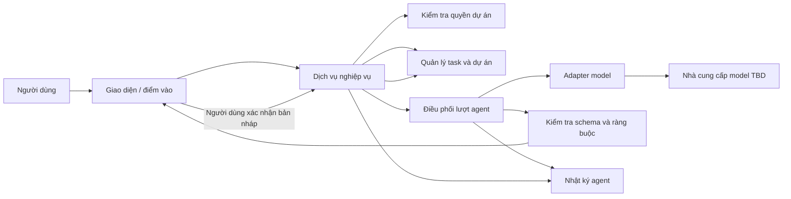

# Kiến trúc hệ thống

## Trạng thái

- Draft v0.1, tài liệu định hướng cho P4; chưa có lựa chọn công nghệ hoặc kiến trúc được duyệt.
- Repo đang ở POC, P1–P3; README ghi chưa có code sản phẩm. POC chỉ bắt đầu sau G1.
- Những phần ghi TBD là câu hỏi cần khảo sát hoặc quyết định tại P4/G2, không phải cam kết triển khai.

Nguồn tham khảo: `README.md`, `CONTRIBUTING.md`, `docs/00-process/sdlc-overview.md`, `docs/00-process/gates.md`, `docs/00-process/safety-rules.md`, `docs/01-requirements/vision-brd.md`, `docs/01-requirements/srs.md` và `docs/01-requirements/traceability.md`; quy trình gốc *Quy trình phát triển phần mềm có AI tham gia*, các mục về P4, truy vết, an toàn và gate. Repo GitHub hiện mô tả sản phẩm ở POC, P1–P3 và chưa có code.

## Mục tiêu kiến trúc

Thiết kế tương lai cần hỗ trợ một công cụ quản lý task có agent đề xuất task nháp từ mục tiêu; người dùng xác nhận trước khi dữ liệu chính thức thay đổi. Thiết kế phải giữ được các thuộc tính sau:

- Ranh giới quyền dự án được kiểm tra trong ứng dụng, không giao cho model tự quyết.
- Agent chỉ có quyền tối thiểu, đầu ra có cấu trúc và được kiểm tra trước khi hiển thị/áp dụng.
- Hành động ghi cần xác nhận người dùng; log đủ để truy vết.
- Thành phần nghiệp vụ có thể kiểm thử độc lập với model bên ngoài.
- Lỗi model hoặc tích hợp không làm hỏng hay ghi dở dữ liệu chính thức.
- Các lựa chọn thiết kế truy về FR/NFR và được ghi thành ADR trước G2.

## Phạm vi và giả định

### Trong phạm vi yêu cầu hiện tại

Quản lý task cơ bản (tạo, đổi trạng thái, hạn chót và nhãn quá hạn); agent đề xuất task nháp; xử lý đầu vào mơ hồ; xác nhận trước khi ghi; giới hạn công cụ và số vòng; log lượt chạy; phân quyền dữ liệu theo dự án.

### Ngoài phạm vi POC hiện tại

Không giả định có đăng nhập, thanh toán, thông báo, tích hợp dịch vụ ngoài, ứng dụng di động hay agent tự ghi dữ liệu. MVP có cần đăng nhập hay không vẫn là câu hỏi mở trong SRS/BRD. POC và Demo dùng dữ liệu tổng hợp; code thử nghiệm là throwaway, không đưa thẳng vào MVP.

### Giả định kiến trúc tạm thời

- Hệ thống có giao diện người dùng, lớp điều phối nghiệp vụ, kho task/dự án và một adapter model; đây là các ranh giới logic để khảo sát, chưa phải quyết định triển khai.
- Chức năng tạo/sửa task thủ công và chức năng đề xuất bằng agent dùng cùng quy tắc nghiệp vụ, nhưng agent không gọi trực tiếp kho dữ liệu.
- Thí nghiệm so sánh model ở `experiments/` tách khỏi sản phẩm; dùng prompt chung và dữ liệu giả theo `experiment-protocol.md`.

## Sơ đồ ngữ cảnh logic

Sơ đồ chỉ mô tả ranh giới trách nhiệm đề xuất. Công nghệ, triển khai vật lý, giao thức, lưu trữ và nhà cung cấp chưa được chọn.

## Luồng chính: chia mục tiêu thành task

1. Điểm vào nhận mục tiêu và định danh dự án.
2. Lớp nghiệp vụ kiểm tra dữ liệu đầu vào và quyền người dùng đối với dự án.
3. Lớp điều phối tạo lượt có giới hạn, lấy ngữ cảnh tối thiểu được phép và gọi adapter model.
4. Adapter gửi yêu cầu theo hợp đồng đã định nghĩa; kết quả model được xem là dữ liệu không đáng tin cậy.
5. Bộ kiểm tra xác thực schema, kích thước, số lượng và ràng buộc cứng. Lỗi không được chuyển thành lệnh gọi công cụ.
6. Giao diện hiển thị bản nháp và yêu cầu người dùng xem/sửa/chấp nhận từng task.
7. Khi chấp nhận, lớp nghiệp vụ kiểm tra lại quyền và bản nháp rồi mới ghi dữ liệu trong một thao tác nhất quán.
8. Ghi sự kiện audit cho kết quả, quyết định người dùng và lỗi. Không ghi secret hoặc dữ liệu thật chưa được phép.

Luồng chi tiết phải đáp ứng FR-020 đến FR-025, FR-030 và FR-040; AC và test được liên kết trong `traceability.md`.

## Trách nhiệm thành phần dự kiến

| Thành phần logic | Trách nhiệm | Ranh giới an toàn |
| --- | --- | --- |
| Giao diện/điểm vào | Nhận mục tiêu, trình bày task nháp, nhận xác nhận rõ ràng | Không coi văn bản trong đầu vào là quyền hạn; không tự xác nhận |
| Dịch vụ nghiệp vụ | Áp dụng quy tắc task và điều phối use case | Là nơi quyết định hợp lệ cuối cùng trước khi ghi |
| Kiểm tra quyền | Xác nhận user/project ở mỗi thao tác đọc hoặc ghi | Từ chối mặc định; không tin project ID do model trả về |
| Điều phối agent | Quản lý lượt, ngữ cảnh tối thiểu, giới hạn vòng và timeout | Không có quyền ghi trực tiếp; giới hạn tối đa 3 vòng |
| Adapter model | Đóng gói yêu cầu/đáp ứng và xử lý lỗi nhà cung cấp | Không chứa bí mật trong log; nhà cung cấp TBD |
| Kiểm tra đầu ra | Kiểm tra schema, giới hạn và ràng buộc xác định | Kết quả model không được thực thi trực tiếp |
| Quản lý task/dữ liệu | Đọc/ghi task và trạng thái qua nghiệp vụ | Ghi chỉ sau xác nhận; phân tách dữ liệu dự án |
| Audit | Lưu model/prompt version, tham chiếu input, hành động và thời điểm | Quyền truy cập, retention và redaction TBD |

Chi tiết trách nhiệm, phụ thuộc và ánh xạ FR nằm trong `module-map.md`.

## Yêu cầu chất lượng và quyết định còn thiếu

| Chủ đề | Ràng buộc đã biết | Cần quyết định ở P4 |
| --- | --- | --- |
| Hiệu năng | NFR-010 có ngưỡng TBD | Mục tiêu, phân vị đo, timeout và cách tính |
| Chi phí | NFR-011 có ngưỡng TBD | Ngân sách mỗi lượt và đo usage của nhà cung cấp |
| Chất lượng đề xuất | NFR-012 có ngưỡng TBD | Thang chấm, tập ca và ngưỡng do PO khóa |
| Bảo mật/quyền riêng tư | Dữ liệu synthetic ở POC; dữ liệu cấm trong prompt theo safety rules | Nhà cung cấp, lưu giữ dữ liệu, vùng lưu trữ và redaction |
| Khả dụng | Chưa có SLO ở giai đoạn này | Hành vi khi model không sẵn sàng, retry và fallback thủ công |
| Công nghệ/triển khai | Chưa có code hoặc stack đã chốt | Ngôn ngữ, lưu trữ, giao diện, môi trường và sơ đồ triển khai |
| Xác thực | MVP có cần đăng nhập còn mở | Cơ chế danh tính và phân quyền nếu nằm trong scope |

Không tự điền số liệu hoặc chọn nhà cung cấp thay PO/Tech Lead. Quyết định đã chốt phải có căn cứ, lựa chọn bị loại và hậu quả trong `docs/02-design/decisions/`.

## Ranh giới lỗi và giao dịch

- Không có kết quả model, kết quả sai định dạng hoặc timeout: giữ nguyên dữ liệu chính thức, báo lỗi có thể hiểu và cho phép người dùng quyết định thử lại.
- Không đạt ràng buộc cứng: không trình kết quả như bản nháp có thể áp dụng.
- Mất quyền giữa lúc đề xuất và xác nhận: kiểm tra lại ở thời điểm ghi và từ chối nếu quyền không còn.
- Lỗi khi ghi nhiều task: thiết kế phải tránh trạng thái ghi một phần hoặc hiển thị rõ task nào đã được lưu; chọn giao dịch/chiến lược tại P4.
- Nhật ký lỗi ghi thất bại: chính sách fail closed/open và ảnh hưởng luồng cần chốt trước G2.

## Triển khai theo giai đoạn

- POC: kiểm chứng giả thuyết agent tách việc có chạy và đủ tin cậy không; dữ liệu giả, code bỏ đi.
- Demo: trình diễn luồng đã giới hạn; không thay thế UAT hoặc cam kết scope.
- MVP: chỉ đưa vào sau thiết kế, kiểm thử, gate và quyết định scope; viết lại phần thử nghiệm cần thiết.
- Production: chưa nằm trong trạng thái repo hiện tại; cần CR, threat model, vận hành, rollback và sign-off riêng.

## Điều kiện sẵn sàng cho G2

- Mọi FR có thiết kế và traceability tới task; threat model hoàn thành.
- Chọn công nghệ và kiến trúc bằng ADR; làm rõ sơ đồ triển khai, hợp đồng API/model và data model.
- Có test strategy cho quyền dự án, xác nhận, đầu vào độc hại, lỗi model và ràng buộc cứng.
- Chốt NFR, chính sách log/retention, xử lý lỗi và giới hạn sử dụng.
- Tech Lead/Architect và reviewer theo `gates.md` xem bằng chứng; chỉ người có thẩm quyền sign-off.

## Tài liệu liên quan

- `agent-autonomy.md`: quyền và giới hạn agent.
- `module-map.md`: ranh giới module và truy vết yêu cầu.
- `threat-model.md`: tài sản, ranh giới tin cậy và biện pháp giảm thiểu.
- `docs/00-process/gates.md`: điều kiện G2 và bằng chứng.
- `docs/01-requirements/`: BRD, SRS, AC và traceability.

## Phiên bản

- v0.1, 12/11/2026: Bản nháp logic, chưa chọn stack; chờ P4 và G2.
