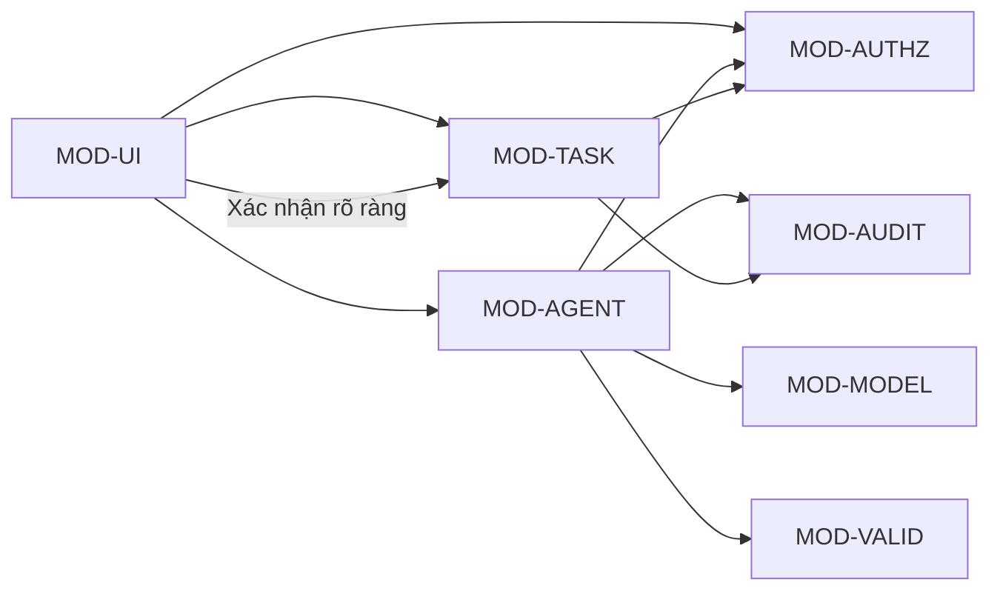

# Bản đồ module

## Trạng thái

- Draft v0.1, bản đồ logic ban đầu; chưa có code sản phẩm và chưa được duyệt ở G2.
- Module là ranh giới trách nhiệm đề xuất, không khẳng định cấu trúc package hay công nghệ.

Nguồn: `docs/01-requirements/srs.md`, `docs/01-requirements/acceptance-criteria.md`, `docs/01-requirements/traceability.md`, `docs/02-design/architecture.md` và quy tắc phân quyền/an toàn trong `docs/00-process/safety-rules.md`.

## Nguyên tắc phân module

- Một module có trách nhiệm rõ, giao diện kiểm thử được và không vượt ranh giới quyền.
- Luật nghiệp vụ nằm trong ứng dụng; model không được quyết định quyền truy cập hay ghi dữ liệu.
- Mỗi FR có module chịu trách nhiệm chính; các module dùng chung được ghi rõ.
- Chi tiết package, service, API và data model sẽ được chốt ở P4 bằng ADR/thiết kế chi tiết.

## Danh sách module logic

| Mã | Module | Trách nhiệm | Không chịu trách nhiệm |
| --- | --- | --- | --- |
| MOD-UI | Điểm vào và giao diện | Nhận yêu cầu, hiển thị task, bản nháp và xác nhận của người dùng | Không áp dụng quyền hoặc tự ghi trực tiếp |
| MOD-TASK | Nghiệp vụ task | Tạo task, chuyển trạng thái, hạn chót và xác định quá hạn | Không gọi model |
| MOD-AUTHZ | Quyền dự án | Kiểm tra quyền người dùng trên từng dự án và thao tác | Không tin quyền do agent/model cung cấp |
| MOD-AGENT | Điều phối agent | Quản lý lượt chia việc, ngữ cảnh, số vòng, timeout và hủy | Không ghi trực tiếp task chính thức |
| MOD-MODEL | Adapter model | Gọi nhà cung cấp qua hợp đồng chung, chuẩn hóa lỗi/phản hồi | Không giữ quyết định nghiệp vụ hoặc quyền dữ liệu |
| MOD-VALID | Kiểm tra đầu vào/đầu ra | Kiểm tra schema, giới hạn và ràng buộc cứng | Không dùng model để phán pass/fail quy tắc xác định |
| MOD-AUDIT | Nhật ký agent | Ghi metadata lượt chạy, hành động, xác nhận, lỗi và thời điểm | Không lưu secret hoặc dữ liệu cá nhân không cần thiết |

Các module có thể được gộp/tách sau khi chọn kiến trúc. Mọi thay đổi ranh giới cần giữ nguyên kiểm soát bảo mật và cập nhật traceability.

## Phụ thuộc logic

MOD-AGENT chỉ nhận dữ liệu cần thiết và trả bản nháp. Thao tác xác nhận đi qua luật nghiệp vụ và kiểm tra quyền lần nữa.

## Ánh xạ yêu cầu

| Yêu cầu | Module chính | Module hỗ trợ | Lưu ý kiểm chứng |
| --- | --- | --- | --- |
| FR-010: tạo task | MOD-TASK | MOD-UI, MOD-AUTHZ | Tiêu đề hợp lệ, tạo trong đúng dự án |
| FR-011: đổi trạng thái | MOD-TASK | MOD-UI, MOD-AUTHZ | Ghi trạng thái và thời điểm chuyển |
| FR-012: nhãn quá hạn | MOD-TASK | MOD-UI | Quy tắc ngày/múi giờ phải thống nhất AC |
| FR-013: đặt hạn chót | MOD-TASK | MOD-UI, MOD-AUTHZ | Đang chờ đồng bộ mã AC theo SRS |
| FR-020: đề xuất task nháp | MOD-AGENT | MOD-MODEL, MOD-VALID, MOD-UI | Không biến đầu ra thành task chính thức |
| FR-021: đầu vào mơ hồ/sai | MOD-AGENT | MOD-VALID, MOD-UI | Hỏi lại hoặc báo lỗi; không tạo nháp không hợp lệ |
| FR-022: allowlist công cụ | MOD-AGENT | MOD-AUTHZ, MOD-VALID | Mặc định từ chối công cụ ngoài danh sách |
| FR-023: xác nhận trước khi ghi | MOD-TASK | MOD-UI, MOD-AUTHZ, MOD-AGENT | Xác nhận bản nháp cụ thể và kiểm tra lại quyền |
| FR-024: prompt injection | MOD-AGENT | MOD-VALID, MOD-MODEL | Nội dung người dùng là dữ liệu, không phải chính sách |
| FR-025: tối đa 3 vòng | MOD-AGENT | MOD-AUDIT | Dừng cứng khi hết số vòng |
| FR-030: audit log | MOD-AUDIT | MOD-AGENT, MOD-MODEL, MOD-TASK | Metadata, đầu vào/đầu ra theo chính sách được duyệt |
| FR-040: cách ly dự án | MOD-AUTHZ | MOD-TASK, MOD-AGENT | Kiểm tra phía ứng dụng cho mọi lần đọc/ghi |
| NFR-010: độ trễ | MOD-AGENT | MOD-MODEL, MOD-AUDIT | Ngưỡng TBD; đo trên tập ca mẫu |
| NFR-011: chi phí | MOD-AUDIT | MOD-MODEL, MOD-AGENT | Ngưỡng TBD; đo theo mỗi lượt |
| NFR-012: chấp nhận task nháp | MOD-AGENT | MOD-UI, MOD-AUDIT | Định nghĩa “sửa nhẹ” và ngưỡng TBD |

## Quy ước giao tiếp và dữ liệu

- Module nghiệp vụ chỉ nhận định danh người dùng/dự án từ ngữ cảnh đã xác thực; không lấy quyền từ nội dung prompt.
- Hợp đồng của MOD-AGENT cần phân biệt rõ `Draft`, lỗi, yêu cầu làm rõ và lượt bị hủy.
- Đầu ra model phải qua MOD-VALID trước khi hiển thị; tool call chỉ được dispatch sau allowlist và kiểm tra quyền.
- MOD-TASK xác nhận lại quyền và tính hợp lệ ngay trước khi ghi.
- MOD-AUDIT nhận event có cấu trúc và mã lượt để liên kết các bước; tránh lưu dữ liệu nhạy cảm nếu không cần.
- Schema, API, chế độ đồng bộ và transaction TBD tại P4.

## Câu hỏi cần xử lý ở P4

- MOD-AUTHZ xác thực danh tính ra sao nếu MVP có đăng nhập?
- MOD-TASK dùng kho dữ liệu nào và phân vùng dữ liệu thế nào?
- Hợp đồng model và lưu lượng dữ liệu qua nhà cung cấp được giới hạn ra sao?
- Nhật ký giữ dữ liệu gì, ai được xem và lưu trong bao lâu?
- Giao dịch chấp nhận nhiều task xử lý lỗi một phần thế nào?
- Ngưỡng NFR nào được PO chốt và module nào phát metric?

## Truy vết

Mã FR/NFR và AC có thể đổi khi SRS được duyệt. Đồng bộ bảng này với `docs/01-requirements/traceability.md` sau G1; ở G2, mọi FR phải có thiết kế và mọi task phải truy về FR. Không coi bảng module là bằng chứng thay cho test case của từng AC.

## Phiên bản

- v0.1, 12/11/2026: Bản đồ module logic ban đầu, dựng theo SRS hiện có; chờ quyết định P4/G2.
