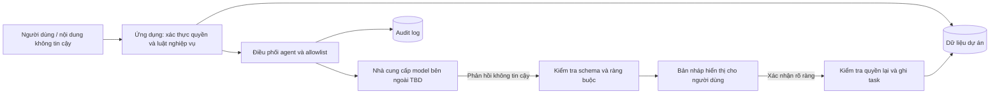

# Threat model

## Trạng thái

- Draft v0.1, threat model khởi đầu cho P4; chưa qua review Security/Tech Lead và G2.
- Hệ thống chưa có code hoặc triển khai sản phẩm. Các ranh giới hạ tầng, danh tính và nhà cung cấp model còn TBD.
- POC dùng dữ liệu synthetic; không nhập secret hoặc dữ liệu cá nhân thật vào repo, prompt hay thí nghiệm.

Nguồn: `docs/00-process/safety-rules.md`, `docs/00-process/gates.md`, `docs/01-requirements/vision-brd.md`, `docs/01-requirements/srs.md`, `docs/01-requirements/acceptance-criteria.md` và `docs/02-design/agent-autonomy.md`; quy trình gốc *Quy trình phát triển phần mềm có AI tham gia*, mục về threat modeling, dữ liệu, an toàn agent và truy vết. Đây là danh sách rủi ro ban đầu, không phải đánh giá bảo mật đã hoàn tất.

## Phạm vi và giả định

Phạm vi xem xét: luồng nhập mục tiêu, lấy dữ liệu dự án, gọi model để đề xuất task nháp, kiểm tra kết quả, người dùng xác nhận, ghi task và lưu audit log.

Giả định tạm thời:

- Agent hoạt động ở L2 và không có quyền ghi task chính thức.
- Model và mọi nội dung người dùng là không đáng tin cậy.
- Quyền truy cập phải được kiểm tra trong ứng dụng ở thời điểm đọc và ghi.
- POC/Demo sử dụng dữ liệu giả. Triển khai thực tế, đăng nhập, network, kho dữ liệu và nhà cung cấp model chưa chọn.

## Tài sản cần bảo vệ

| Tài sản | Tác động khi bị xâm phạm |
| --- | --- |
| Task, mục tiêu và dữ liệu dự án | Lộ nội dung, sửa sai hoặc mất dữ liệu |
| Phân tách dự án và danh tính người dùng | Người dùng đọc/ghi dữ liệu ngoài quyền |
| Bản nháp và quyết định xác nhận | Task không được duyệt bị ghi như task chính thức |
| Công cụ và quyền agent | Thực hiện hành động ngoài phạm vi |
| Prompt, đầu vào/đầu ra và nhật ký | Lộ dữ liệu, khó điều tra hoặc tái lập |
| Bí mật/tokens và cấu hình kết nối | Truy cập trái phép dịch vụ hoặc tài khoản |
| Tính sẵn sàng và ngân sách model | Gián đoạn dịch vụ hoặc chi phí vượt ngưỡng |

## Ranh giới tin cậy

Ranh giới cụ thể như mạng, secrets manager, mã hóa khi lưu/truyền và kiểm soát truy cập log chưa thể đánh giá cho đến khi kiến trúc triển khai được chốt.

## Các mối đe dọa và kiểm soát dự kiến

| ID | Đe dọa / tình huống | Tác động | Kiểm soát dự kiến | Kiểm tra / truy vết |
| --- | --- | --- | --- | --- |
| TM-01 | Prompt injection trong mục tiêu hoặc mô tả task yêu cầu agent bỏ quy tắc, gọi công cụ cấm | Vượt phạm vi, rò rỉ hoặc hành động sai | Coi nội dung là dữ liệu; chính sách và allowlist nằm ngoài prompt; không cấp công cụ phá hoại; kiểm tra tool call phía ứng dụng | FR-022, FR-024; ca injection trong eval/test |
| TM-02 | Agent đọc chéo dữ liệu dự án do ID bị sửa hoặc ngữ cảnh model yêu cầu | Lộ dữ liệu giữa dự án | Kiểm tra quyền server-side cho mỗi lần đọc; không dựa vào ID/quyền do model cung cấp; kiểm thử cách ly | FR-040, AC-FR-040-1 |
| TM-03 | Đầu ra model sai schema, chứa lệnh hoặc payload bất thường được áp dụng như dữ liệu hợp lệ | Ghi dữ liệu sai hoặc kích hoạt hành vi ngoài dự kiến | Xác thực schema, giới hạn kích thước và escape khi hiển thị; đầu ra không thực thi trực tiếp; từ chối nếu sai | FR-020–022; test đầu ra lỗi/độc hại |
| TM-04 | Bản nháp thay đổi sau khi người dùng xem nhưng xác nhận cũ vẫn được chấp nhận | Ghi nội dung ngoài ý định | Xác nhận gắn với phiên bản/hash bản nháp; vô hiệu xác nhận khi bản nháp đổi; thao tác ghi yêu cầu xác nhận rõ | FR-023; test sửa sau xác nhận |
| TM-05 | Quyền bị thu hồi giữa lúc đề xuất và lúc ghi | Ghi task trái quyền | Kiểm tra quyền lần nữa ngay trước ghi; từ chối toàn bộ thao tác không còn hợp lệ | FR-023, FR-040 |
| TM-06 | Người dùng gửi đầu vào quá dài, lặp yêu cầu hoặc buộc nhiều lượt model | Cạn tài nguyên, chi phí hoặc từ chối dịch vụ | Giới hạn độ dài, số task, timeout, tần suất và tối đa 3 vòng; giá trị cần chốt | FR-025, NFR-010, NFR-011 |
| TM-07 | Model/provider lỗi, timeout hoặc trả kết quả một phần | Mất khả dụng, trạng thái không nhất quán | Timeout, trạng thái lỗi rõ, không ghi khi chưa có kết quả hợp lệ; retry có giới hạn và không nhân đôi thao tác | AC-FR-021; thiết kế retry TBD |
| TM-08 | Audit log lưu prompt/đầu vào có dữ liệu nhạy cảm hoặc bị truy cập trái phép | Rò rỉ thông tin, rủi ro riêng tư | Tối thiểu hóa/che dữ liệu, kiểm soát quyền xem log, retention và quy trình xóa; chính sách TBD | FR-030; test log không chứa dữ liệu cấm |
| TM-09 | Secret bị commit hoặc đưa vào prompt/log | Chiếm quyền dịch vụ, chi phí, rò rỉ | Không đưa secret vào repo/prompt; secret scan; thu hồi ngay nếu lộ; cấu hình secret ngoài dữ liệu | `safety-rules.md`, CI khi có code |
| TM-10 | Ghi nhiều task lỗi giữa chừng tạo trạng thái một phần | Dữ liệu không nhất quán, người dùng hiểu sai | Thiết kế transaction hoặc hiển thị kết quả từng task rõ ràng; thử lỗi ở mọi điểm ghi | FR-023; quyết định P4 |
| TM-11 | Người dùng hiểu task nháp là đúng hoặc đã được chấp nhận | Quyết định sai, mất niềm tin | Gắn trạng thái Draft; phân biệt rõ nút xem/sửa/chấp nhận; không tự chọn xác nhận | FR-020, FR-023 |
| TM-12 | Phụ thuộc provider hoặc nội dung provider lưu giữ dữ liệu vượt kỳ vọng | Lộ dữ liệu hoặc gián đoạn/chi phí | Chỉ gửi dữ liệu tối thiểu; rà chính sách provider trước khi chọn; adapter để kiểm soát thay đổi; provider chưa chọn | Quyết định P4/G2, NFR-010/011 |

## Quy tắc an toàn nền

- Không đưa dữ liệu thật hoặc secret vào prompt; POC/Demo chỉ dùng dữ liệu synthetic theo policy repo.
- Không cấp cho agent công cụ xóa, thanh toán hoặc gửi thông tin ra ngoài.
- Hành động ghi quan trọng cần người dùng xác nhận; xác thực quyền tại ứng dụng.
- Nội dung người dùng, web hoặc model không có thẩm quyền thay đổi policy.
- Giới hạn vòng tự chạy ở 3; khi hết giới hạn dừng và thông báo.
- AI không duyệt, ký gate, chấp nhận rủi ro hoặc nghiệm thu thay người dùng.

## Ưu tiên xử lý ban đầu

Các rủi ro cần giải quyết trong thiết kế trước G2: cách ly dữ liệu (TM-02), prompt injection/tool abuse (TM-01), đầu ra model không tin cậy (TM-03), xác nhận và quyền ghi (TM-04/05), cùng log và dữ liệu gửi cho provider (TM-08/12). Mức độ/rủi ro còn lại do con người xác nhận; không coi việc có kiểm soát đề xuất là bằng chứng rằng rủi ro đã được chấp nhận.

## Câu hỏi mở cần trả lời ở P4

- Có đăng nhập trong MVP không; danh tính và phiên được xác minh thế nào?
- Nhà cung cấp model nào, dữ liệu nào được gửi, nơi xử lý và retention ra sao?
- Log lưu nội dung hay chỉ tham chiếu/hash; ai có quyền xem, thời hạn lưu bao lâu?
- Giới hạn độ dài, tần suất, timeout, số task và chi phí là bao nhiêu?
- Cơ chế xác nhận bản nháp, transaction nhiều task, hủy và retry ra sao?
- Có cơ chế tắt agent nhanh và đường làm thủ công không?
- Threat model cập nhật theo kiến trúc triển khai và kiểm thử nào cần Security/reviewer độc lập?

## Phiên bản

- v0.1, 12/11/2026: Bản threat model ban đầu từ yêu cầu và quy tắc an toàn; cần review và cập nhật sau khi chốt kiến trúc tại P4.
