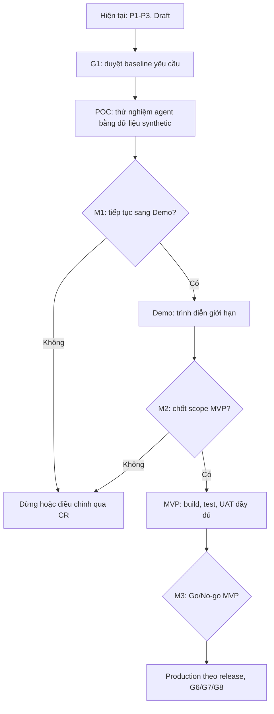

# Roadmap dự án

## Trạng thái

- Draft v0.1, kế hoạch theo gate và điều kiện hoàn tất; chưa có lịch tuần hoặc ngày cam kết.
- Repo hiện ở P1–P3, Product stage POC, gate kế tiếp G1; chưa có code sản phẩm.
- Các mục “TBD” cần người có thẩm quyền chốt. Không xem giai đoạn tương lai là đã được cấp phép trước khi gate tương ứng sign-off.

Nguồn: `README.md`, `docs/00-process/sdlc-overview.md`, `docs/00-process/gates.md`, `docs/06-roadmap/plan.md` bản hiện có (chỉ có tiêu đề), `docs/01-requirements/` và `docs/00-process/experiment-protocol.md`. Các ngày/ước lượng không có dữ liệu nên không tự đặt.

## Mục tiêu

Kiểm chứng theo từng bước liệu agent có thể tách mục tiêu thành task nháp đủ tin cậy, có thể đo lường và luôn giữ quyền xác nhận ở con người. Sản phẩm hiện là POC; không cam kết MVP/Production trước các milestone và review tương ứng.

## Bức tranh roadmap

Đây là luồng dự kiến theo `gates.md`; người ký/điều kiện M3 và M4 còn TBD trong tài liệu quy trình và cần được làm rõ trước khi áp dụng.

## Giai đoạn hiện tại: hoàn tất P1–P3 và chuẩn bị G1

| Việc | Kết quả mong đợi | Tình trạng theo repo | Điều kiện hoàn tất |
| --- | --- | --- | --- |
| Làm rõ CR-001, bối cảnh và scope | CR, BRD và câu hỏi mở được PO xác nhận | Draft/còn giả định trong `vision-brd.md`, SRS | PO chốt phạm vi, ưu tiên, giả định và câu hỏi blocker |
| Đồng bộ SRS, AC và traceability | Mỗi FR/NFR có AC; FR truy về CR | Bản nháp còn mã AC cần đổi và ngưỡng TBD | Không còn finding blocker; bảng nhất quán |
| Chốt NFR và KPI POC | Ngưỡng đo được, cách đo và tập ca | NFR/KPI còn placeholder | PO chọn và khóa ngưỡng trước khi chạy chính thức |
| Review và ký G1 | Baseline SRS/AC/traceability | G1 là gate kế tiếp theo README | Sign-off PO và khách hàng theo `gates.md`; cập nhật trạng thái/tag theo quy ước |

Không triển khai POC chính thức trước khi G1 qua; có thể chuẩn bị cấu trúc, dữ liệu tổng hợp và draft test/eval để review.

## Sau G1: thiết kế và POC

| Giai đoạn | Công việc dự kiến | Bằng chứng/đầu ra | Gate hoặc quyết định |
| --- | --- | --- | --- |
| P4–P6: thiết kế | Chọn kiến trúc/công nghệ; hoàn thiện threat model, module map, quyền agent, test strategy và backlog | ADR, thiết kế chi tiết, threat model, test cases, ma trận truy vết cập nhật | G2; reviewer độc lập theo `gates.md` |
| POC | Thử giả thuyết agent trên dữ liệu synthetic; so sánh model theo prompt/bộ ca đã khóa nếu thực hiện | Code throwaway trong `poc/`, kết quả thô, ai-log, scorecard | Mốc POC nội bộ: yêu cầu/AC được duyệt trước, eval khóa trước, scorecard PO duyệt (quy tắc đề xuất trong gates) |
| M1 | Quyết định tiếp tục sang Demo, điều chỉnh hay dừng | Kết quả POC, giới hạn mẫu, rủi ro và bài học | Tech Lead và PO ký theo `gates.md` |

POC không đưa code thẳng vào MVP. Kết quả 0 vi phạm trên bộ mẫu nhỏ chỉ cho phép nói “chưa thấy vi phạm”, không chứng minh an toàn.

## Demo, MVP và vận hành

| Giai đoạn | Công việc dự kiến | Bằng chứng/đầu ra | Điều kiện chuyển tiếp |
| --- | --- | --- | --- |
| Demo | Trình diễn luồng và kiểm tra giả định với dữ liệu tổng hợp/anonymized; quản lý scope riêng | Demo, phản hồi và CR mới nếu phát sinh | Không coi Demo là UAT hay cam kết; M2 do PO/Sponsor ký |
| MVP | Chốt scope; xây lại phần cần thiết qua G2/G3/G4; kiểm thử P9 và UAT P10 | PR/CI, báo cáo G5, UAT và sign-off G6 | MVP cắt scope, không cắt test/bảo mật/traceability; M3 Go/No-go cần chốt người ký |
| Production | Release theo checklist, deploy có rollback, monitoring và vận hành | Release package, G7, metric/incident/retro G8 | M4/người ký và SLO cần xác định; mỗi release vẫn phải qua G6/G7/G8 |

Các giai đoạn này là hướng đi, không phải quyết định đã duyệt hoặc lịch cam kết.

## Phụ thuộc và việc chặn

- G1 phụ thuộc PO chốt scope, các AC, mã yêu cầu và ngưỡng NFR.
- G2 phụ thuộc G1, kiến trúc và threat model được review, backlog truy về FR và test strategy có coverage.
- POC phụ thuộc G1 và protocol thí nghiệm khóa; dùng synthetic, không dùng dữ liệu thật.
- M1 phụ thuộc scorecard đã được kiểm tra và PO duyệt.
- MVP phụ thuộc M2 chốt scope, G2, code review/CI, G5 và UAT/G6.
- Production phụ thuộc người ký M3/M4, năng lực rollback/monitoring và quyết định rủi ro của con người.

## Cách theo dõi và cập nhật

- Mỗi dòng công việc phải có owner, trạng thái, CR/FR liên quan, bằng chứng và phụ thuộc; các giá trị chưa xác định để TBD.
- Cập nhật roadmap cùng PR khi scope, trạng thái gate hoặc thứ tự ưu tiên đổi.
- Thay đổi yêu cầu sau G1 tạo CR mới và impact analysis; không sửa baseline âm thầm.
- Không ghi ngày hoàn tất trước khi có ước lượng/commitment của người thực hiện.
- Trạng thái dùng: Chưa bắt đầu, Đang làm, Chờ duyệt, Approved, Bị chặn; gate chỉ Approved khi người đúng thẩm quyền ký.

## Câu hỏi cần chốt

- Ai xác nhận phạm vi CR-001 và các giả định người dùng?
- Ngưỡng KPI/NFR nào là điều kiện POC đạt?
- M3, M4 ai ký và tiêu chí cụ thể nào áp dụng?
- Có đăng nhập trong scope MVP không; người dùng UAT là ai?
- Khi nào phân bổ nguồn lực và lịch thực tế? Chưa có cơ sở đặt ngày trong tài liệu hiện tại.

## Phiên bản

- v0.1, 12/11/2026: Bản roadmap theo trạng thái repo và gate; không đặt lịch giả định.
